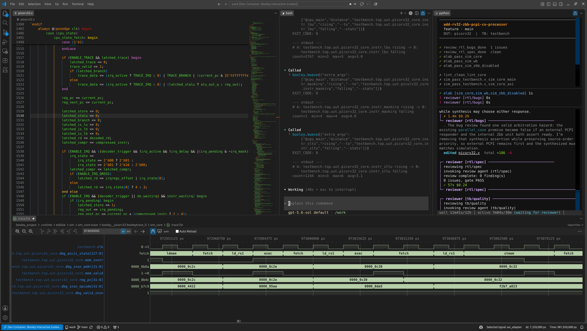

# Booley

**The open-source agentic RTL IDE**

[](https://github.com/boldaxolotl/Booley/actions/workflows/test.yml)
[](https://pypi.org/project/booley-rtl/)
[](https://opensource.org/licenses/Apache-2.0)
[](https://www.python.org/downloads/)

Booley turns Claude Code or Codex into a capable RTL assistant. It runs the Developer Agent in a sandbox, hands it real EDA tools, and checks its work against your acceptance criteria: passing tests, area and timing budgets, cycle counts, coverage, and more. You design; it does the grunt work.

**Website:** [boldaxolotl.github.io/booley](https://boldaxolotl.github.io/booley/) for the full feature tour, videos, and blog.



## What it does

- **Typed EDA Flows:** `sim`, `lint`, `synth`, and `fpga` replace per-repo glue Tcl scripts. Each Flow runs an EDA job end to end and returns a structured result: pass/fail plus metrics such as area, timing, or cycle counts, not just raw logs. Flows are built on FuseSoC, and the interface stays the same across tools and projects: `sim` stays `sim` whether it runs Verilator today or Xcelium tomorrow.
- **Reproducible team environment:** Configure the project once, and its Docker environment supplies the same pinned EDA stack, agent tooling, and system dependencies to everyone on the project ([why Docker](https://github.com/boldaxolotl/Booley/blob/main/docs/internals/WHY.md#why-docker)).
- **One VS Code window:** RTL work is usually scattered across editors, tool-specific commands, build environments, logs, and waveform viewers. Booley puts RTL, agent sessions, terminals, EDA runs, waveforms, and the Booley Dashboard side by side in one VS Code window.
- **Sandboxed Developer Agent:** Booley treats the agent like a talented junior engineer. It can write RTL and testbenches, but it is inexperienced with EDA tools, prone to questionable design decisions, and too risky to give unrestricted host access. So the agent and every command it runs stay inside a Docker container with restricted mounts and network access, and its work goes through explicit specifications, automated checks, and human review. That lets it work unattended.
- **Goal Mode:** You set mandatory Goals up front, such as `SYNTH:synth_fifo (area increase ≤ 10%)` or `COVERAGE:sim_fifo (line ≥ 90%, tests all)`. Goals cover passing tests, lint, area, timing, cycle counts, coverage, mutation testing, and code review. Booley checks each one in deterministic code against fresh recorded Flow results, not against the agent's claim of success ([details](https://github.com/boldaxolotl/Booley/blob/main/docs/user/USAGE.md#goal-mode)).
- **Waveform queries:** `bwave` lets the agent find, sample, snapshot, and measure real simulation traces. Ask "When did `data_o` equal `0xDEADBEEF`?" and it answers from simulation data instead of guessing from RTL.

[FEATURES.md](https://github.com/boldaxolotl/Booley/blob/main/docs/user/FEATURES.md) is the complete feature reference.

## Quick Start

Three ways in, ordered by how much you want to invest:

1. **[Level 1: Watch](#level-1-watch).** See an engineer drive Booley on a demo project, start to finish. Zero setup.
2. **[Level 2: Try the demo yourself](#level-2-try-the-demo-yourself).** Clone the configured demo, open it in VS Code, and type your first request to the agent.
3. **[Level 3: Use it on your own project](#level-3-use-it-on-your-own-project).** Full integration on your own RTL.

### Level 1: Watch

Two videos on the [Videos page](https://boldaxolotl.github.io/booley/videos/) show an engineer driving Booley on a demo project end to end, so you can see the workflow before touching anything.

### Level 2: Try the demo yourself

**[Follow the demo repository's README](https://github.com/boldaxolotl/booley-prj-picorv32/blob/e53c1896ab02595aa4ebb3a56b5aa7bd109177f9/README.md)** to try the demo, after you [install Booley](#installation).

### Level 3: Use it on your own project

Follow [SETUP.md](https://github.com/boldaxolotl/Booley/blob/main/docs/user/SETUP.md) to integrate Booley with your own RTL project, after you [install Booley](#installation).

## Installation

Booley supports Windows and Linux (Ubuntu 26.04 tested); macOS is not
supported. Designs must be SystemVerilog or Verilog: VHDL and UVM are not
supported. You need:

- Python 3.11+
- [Git 2.37.2+](https://git-scm.com/downloads)
- [Docker](https://www.docker.com/), with about **4 GB** free for the image
  (**6 GB** with the RISC-V toolchain) plus room for build artifacts
- [VS Code](https://code.visualstudio.com/)
- An agent CLI on the host PATH with credentials configured for Project Setup:
  [Claude Code](https://code.claude.com/docs/en/setup) (`claude`, the default)
  or [Codex](https://developers.openai.com/codex/cli) (`codex`)

With [pipx installed](https://pipx.pypa.io/latest/how-to/install-pipx.html), install Booley and prepare the host:

<!-- booley-smoke:install -->
```bash
pipx install booley-rtl
booley bootstrap
```
<!-- /booley-smoke:install -->

To upgrade an existing install:

<!-- booley-smoke:upgrade -->
```bash
pipx upgrade booley-rtl
booley bootstrap --update
```
<!-- /booley-smoke:upgrade -->

Seeing `externally-managed-environment`, PATH, or other install errors? See
[Troubleshooting](https://github.com/boldaxolotl/Booley/blob/main/docs/user/TROUBLESHOOTING.md#installation-fails-with-externally-managed-environment).

**Next:** [try the demo](#level-2-try-the-demo-yourself) or [set up your own project](#level-3-use-it-on-your-own-project).

## Supported EDA Tools

Current integrations:

- **Simulate / elaborate** — Verilator, Icarus Verilog; cocotb testbenches supported
- **Lint** — Verilator, Verible
- **ASIC synthesis** (PPA estimate, not tape-out) — logical Yosys or physical Yosys + OpenROAD
- **Waveform debug** — `bwave` (+ VaporView GUI in VS Code)
- **FPGA implementation** — AMD Vivado
- **Coming soon** — Synopsys VCS, Cadence Xcelium

For exact versions, provisioning, trace support, and platform constraints, see
**[SUPPORTED-EDA-TOOLS.md](https://github.com/boldaxolotl/Booley/blob/main/docs/user/SUPPORTED-EDA-TOOLS.md)**.
Support for additional commercial EDA tools is coming soon; see the
[roadmap](https://github.com/boldaxolotl/Booley/blob/main/docs/internals/ROADMAP.md#commercial-eda-tools).

## Documentation

- [Features](https://github.com/boldaxolotl/Booley/blob/main/docs/user/FEATURES.md)
- [Architecture](https://github.com/boldaxolotl/Booley/blob/main/docs/internals/ARCHITECTURE.md)
- [Setup](https://github.com/boldaxolotl/Booley/blob/main/docs/user/SETUP.md)
- [Usage](https://github.com/boldaxolotl/Booley/blob/main/docs/user/USAGE.md)
- [Flow reference](https://github.com/boldaxolotl/Booley/blob/main/docs/user/FLOW_REFERENCE.md)
- [Supported EDA tools](https://github.com/boldaxolotl/Booley/blob/main/docs/user/SUPPORTED-EDA-TOOLS.md)
- [Limitations](https://boldaxolotl.github.io/booley/#limitations)
- [How Booley is built](https://boldaxolotl.github.io/booley/#how-it-is-built)

## Contributing

Booley is still early, so the most useful contribution is trying it and reporting what works, what doesn't, and what you want next. Tell **`/booley-feedback`** in your Developer Agent chat; it gathers and redacts any needed evidence. Opinions need no reproduction, and nothing leaves your machine until you approve the exact text ([feedback guide](https://github.com/boldaxolotl/Booley/blob/main/docs/user/USAGE.md#when-booley-itself-misbehaves), [configuration](https://github.com/boldaxolotl/Booley/blob/main/docs/user/CONFIG.md#feedback-feedback)).

Code and documentation contributions are welcome; see [CONTRIBUTING.md](https://github.com/boldaxolotl/Booley/blob/main/docs/internals/CONTRIBUTING.md). Please keep feedback technical and specific; broader debates about AI's effects on society or employment are outside the project's scope.

For suspected vulnerabilities, follow the private reporting process in [SECURITY.md](https://github.com/boldaxolotl/Booley/blob/main/SECURITY.md) instead of opening a public issue.

## Acknowledgments

Booley stands on a lot of other people's work. Thank you to:

- **The authors of [Edalize](https://github.com/olofk/edalize) and [FuseSoC](https://github.com/olofk/fusesoc)**, and especially their lead maintainer, Olof Kindgren, for the framework that makes Booley's whole idea of a simple, unified CLI-over-EDA interface possible.
- **The author of [vcdvcd](https://github.com/cirosantilli/vcdvcd), Ciro Santilli**, for the VCD-parsing work that seeded the `bwave` idea.
- **The author of [wavepeek](https://github.com/kleverhq/wavepeek)**, another neat waveform-to-CLI EDA tool, for the clean top-level CLI interface that inspired `bwave`'s top-level CLI (the internals started well before wavepeek and are quite different).
- **The author of [VaporView](https://github.com/Lramseyer/vaporview), Lloyd Ramseyer**, for the excellent VS Code waveform viewer that `bwave gui` drives for scoped waveform inspection right in the IDE.
- **The authors of [Yosys](https://github.com/YosysHQ/yosys), [Verilator](https://github.com/verilator/verilator), [Icarus Verilog](https://github.com/steveicarus/iverilog), [Verible](https://github.com/chipsalliance/verible), and [sv2v](https://github.com/zachjs/sv2v)**, for the excellent open-source EDA tools that make Booley possible at all.
- **[Matt Pocock](https://www.aihero.dev/)**, for his great agentic software engineering techniques, which shaped how Booley's agents are built and driven.

## License

Apache 2.0. See [LICENSE](https://github.com/boldaxolotl/Booley/blob/main/LICENSE) for details.
