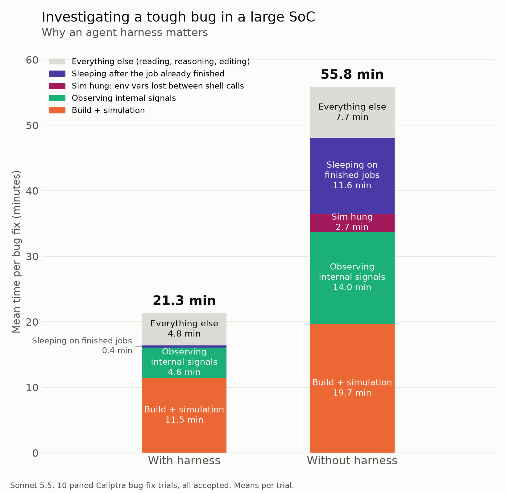
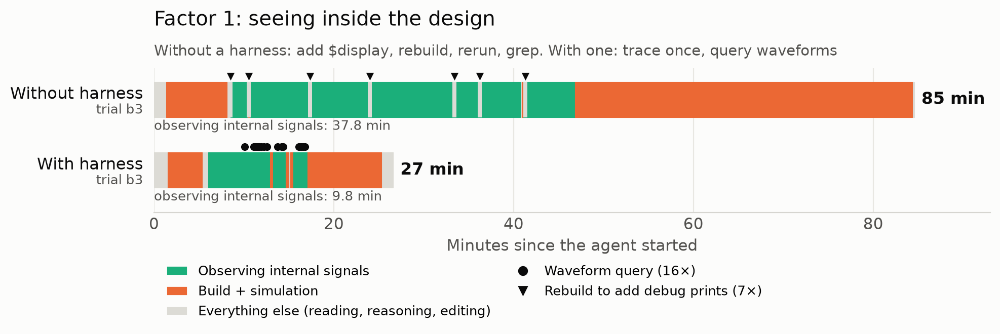
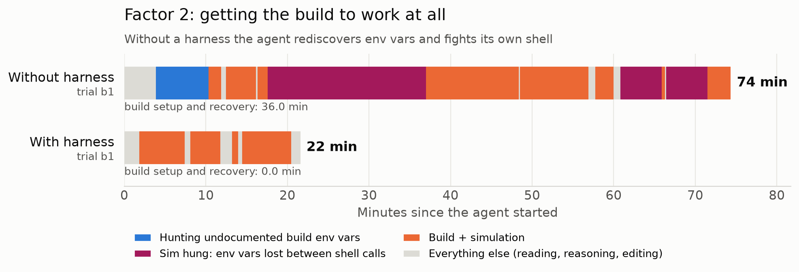
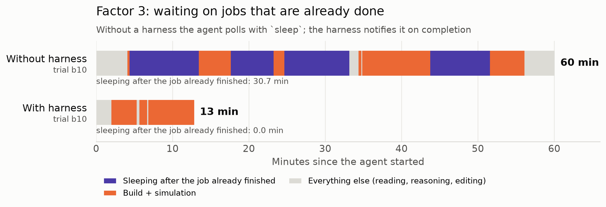

# Investigating a tough bug in a large SoC: why an agent harness matters

I use AI agents in my chip-design frontend work daily. Modern LLMs are quite capable: they can implement complex features and find tricky bugs in large codebases. But the model is only half of it. The other half is the harness: the environment the agent works in and the tools it gets. Since early 2026 I have been experimenting with different parts of the harness, trying to make agents perform better. In this post I want to show what I was able to achieve: how a harness helps an agent investigate, reproduce and fix a hard bug in a large, real SoC.

<!-- more -->

## Setup

I didn't want a toy. I wanted a large, real RTL codebase, so I picked [Caliptra](https://github.com/chipsalliance/caliptra-rtl), the open-source hardware root of trust. It's big, well written, and backed by serious companies.

For the agent I used Anthropic's mid-tier model, Sonnet 5.5. It's a good balance of cost and brains, which is why a lot of people actually run it.

Then I needed a bug. Finding one hard enough took longer than I expected. I screened about 16 candidates: historical upstream fixes reverted back into the tree, plus a few still-open issues. An agent found every one of them just by reading the code, usually within a few minutes, without running a single simulation. Good news for agents, useless for an experiment.

The bug that survived is a real historical fix in the VeeR EL2 core (the RISC-V CPU inside Caliptra) that I put back into the tree. Upstream fixed it in the [VeeR EL2 1.4 release](https://github.com/chipsalliance/Cores-VeeR-EL2/commit/fb3354352be70781450ea70963c44d4b8f88ae9b) in 2021; the [release notes](https://github.com/chipsalliance/Cores-VeeR-EL2/blob/fb3354352be70781450ea70963c44d4b8f88ae9b/release-notes.md) list it as "Store data collision with DCCM DMA error when address is 0x0".

## The bug

The agent got an issue-style bug report. The short version:

> Early in boot, the firmware recomputes a digest over its own ROM image and compares it with a constant fixed at build time. Normally the check passes. In one case the digest comes out wrong, even though the ROM is unchanged and the constant is correct. No fault, no exception, no ECC event, fully deterministic. The trigger is a coding pattern: the failing routine reads ROM word by word and, in the same tight loop, writes partial results to a scratch buffer in DCCM. Keep the accumulator in registers, or move the buffer out of DCCM, and the digest is correct. Only the first word of the ROM input looks corrupted.
>
> Find and fix the RTL root cause. Add a test that reproduces the problem and passes after the fix.

What's actually going on: the core's load/store unit has store-to-load forwarding, and one guard condition is missing (`el2_lsu_bus_intf.sv`, the `& lsu_busreq_r` term). Without it, a store to DCCM wrongly forwards into a following load from ROM address 0. The load returns `0x0` instead of the ROM word.

Finding the fix isn't the hard part. Both arms of the experiment usually pointed at the right line of RTL within 5 minutes, just by reading. The hard part is the second half of the request: writing a test that fails on the buggy design. Two traps make that harder than it sounds:

- The test template marks ROM as a side-effect region, and that disables forwarding. Write the obvious test and the bug never fires.
- Code fetched from uncached ROM is slow, so the store and the load never meet in the pipeline.

So most of each run goes into getting a test to *fail*: build, simulate, look inside, change the test, repeat. That loop is where tools matter.

## The experiment

Two arms, identical except for the harness:

- **Agent:** Claude Code 2.1.289, Sonnet 5.5, medium effort.
- **Same everything else:** same prompt, same container image, 8 CPUs, 10 GB RAM, a 90-minute wall-clock limit, no access to the internet. Caliptra at commit `e379800c`.
- **Without harness:** the agent gets the repo and a shell. Caliptra's own Makefiles and test scripts are all there.
- **With harness:** the same repo plus the harness, described next.

I ran 10 trials in each arm, numbered b1 to b10; trials with the same number form a pair.

## The harness

The harness in this post is [Booley](https://github.com/boldaxolotl/booley), an open-source Python framework I'm building for agentic FPGA and ASIC work. The runs used the published 0.3.0 release.

What the agent gets on top of a plain shell:

- **A `sim` tool.** It's a universal interface between the agent and the simulator. It works with different simulators (Verilator and Icarus Verilog today, commercial ones in progress), and it manages build reuse, trace creation and coverage. The interface stays the same in every project. What mattered most in this experiment is how it waits: the call blocks until the job finishes and returns pass or fail. If the job runs longer than four minutes, the agent gets a run ID and calls `booley_poll`, which blocks again and returns the moment the job exits. No guessing how long to wait.
- **B-Wave**, a custom binary written in Rust that lets agents query waveforms directly. A simulation run with tracing on records a waveform, and the agent asks it questions: list signals, find the first cycle where a condition holds, print a few signals over a window of cycles as a text table, etc.
- **The build system is part of the harness.** Caliptra's sources, simulator flags and firmware build are described once, in FuseSoC core files and a test list. The agent never touches Caliptra's Makefiles or the environment variables they expect. The no-harness agent has a build system too: those Makefiles, which it has to figure out on its own.

The Caliptra project setup used in this experiment: [booley-prj-caliptra](https://github.com/boldaxolotl/booley-prj-caliptra). Its README walks through the setup. Use it to play with Booley on Caliptra, or to rerun this experiment: revert the VeeR fix linked above and give your agent the bug report from "The bug". <!-- TODO: repo is still private; flip visibility before publishing -->

## Results



Both arms fixed the bug 10 times out of 10. With the harness the mean was **21.3 minutes**. Without it, **55.8 minutes**. Medians: 21.4 versus 53.3.

Three harness features account for most of the difference. Here they are, one by one.

## Factor 1: seeing inside the design



When a test doesn't fail the way you expect, you need to see what the pipeline is doing. Without the harness, the agent does what we all did before we knew better: add `$display`, rebuild, rerun, grep. In pair b3 it went around that loop seven times, at about 6.5 minutes per rebuild. That's 37.8 minutes spent looking at signals.

With the harness, the agent built once with tracing on and asked the waveform 16 questions: 9.8 minutes in total.

Here's what those questions look like, from trial b1 (equivalent command lines, output trimmed). The agent's test kept passing on the buggy design, so it asked when the suspicious address match fires:

```
$ bwave find trace.fst '*bus_intf.ld_addr_rhit_lo_lo' 1
cycle 4687 caliptra_top_tb.caliptra_top_dut.rvtop.veer.lsu.bus_intf.ld_addr_rhit_lo_lo 1
cycle 4696 caliptra_top_tb.caliptra_top_dut.rvtop.veer.lsu.bus_intf.ld_addr_rhit_lo_lo 1
...
# 32 matches found
```

32 times. So why does the test pass? It took a snapshot of the first hit:

```
$ bwave value trace.fst --at 4687 -s '*bus_intf.ld_*' -s '*bus_intf.lsu_busreq*' -s '*bus_intf.is_sideeffects_m' ...
# Snapshot at cycle 4687
lsu_busreq_m                             = 1
is_sideeffects_m                         = 1
lsu_busreq_r                             = 0
ld_addr_rhit_lo_lo                       = 1
ld_full_hit_m                            = 0
```

A ROM load matches a store that isn't even on the bus: that's the bug. But the load is flagged as side-effect, so the forward is cancelled and the test passes anyway. The agent changed the test's memory-attribute setting, and half a minute later the test failed on the buggy design.

(The long orange tail of the no-harness run, from 47 to 85 minutes, is its final tests running one after another. It has nothing to do with waveforms.)

Over all ten pairs the waveform saving averages 9.4 minutes.

## Factor 2: getting the build to work at all



Caliptra's simulation Makefiles expect environment variables that aren't documented anywhere obvious (`CALIPTRA_AXI4PC_DIR`, `CALIPTRA_PRIM_ROOT` and friends). All 10 no-harness runs hit them. Most recovered within a few minutes.

Pair b1 shows how badly it can go. From 3.9 to 10.3 minutes the build failed three times while the agent hunted down variables. Then it exported them, but exports don't survive between the agent's shell calls. The next step quietly failed to build `program.hex`, and the simulation, with no program to run, hung until its timeout. That happened three times: 17.6 to 37.0, 60.8 to 65.9 and 66.4 to 71.5 minutes. At 71.5 the agent finally wrote a `run.sh` that set everything in one place. Total spent on setup: 36 minutes (30 minutes counting strictly).

With the harness, none of this can happen, because the build is part of Booley rather than something the agent assembles in a shell:

- **No Makefile variables to hunt.** Booley drives the build through FuseSoC. The paths those variables point to were resolved once, when Caliptra was set up for Booley, and written into its FuseSoC core files. The agent never sees them.
- **No shell state to lose.** Every `sim` call is self-contained. The per-test firmware build (`program.hex` and friends) is a declared step that Booley runs right before each simulation, with everything it needs.
- **No silent hangs on a missing program.** If that firmware build fails, Booley reports the test as failed, with the build error, instead of starting a simulation with nothing to run.

The b1 harness run spent zero minutes on setup. Averaged over all ten pairs it's only 3.6 minutes, because nine of them recovered quickly. b1 is what the tenth looks like.

## Factor 3: waiting on jobs that are already done



This one is a bit embarrassing for Anthropic, but I am going to report it anyway. Without a harness, the agent starts a build in the background and then guesses how long to wait. In b10, at 4.3 minutes, a build failed after one second. The agent had already run `sleep 540` and didn't look again until 13.4 minutes. It did this four times in that run, sleeping through 30.7 of its 60 minutes.

With the harness, the tool call returns when the job is done. The b10 harness run took 13 minutes in total.

Across all ten pairs this is the largest factor: 11.2 minutes on average, and it mattered in 6 pairs. It's also a lower bound, because I counted only sleeps I could pin to a job that had demonstrably finished.

## Summary

Same model, same bug, same prompt. With the harness, Sonnet 5.5 fixed it in 21 minutes on average; without it, in 56. The difference was in everything around that: seeing inside the design without a rebuild per question, a build that works on the first call, and getting the result the moment the job ends. On a hard hardware bug, most of the work is getting a test to fail, and that work runs on tools.

## Disclaimers

1. **The harness helps most on hard bugs**
2. **Smarter models benefit less**
3. **The sample is small:** 10 trials per arm, one model, one bug, one SoC.
4. **I built the harness,** so weigh my enthusiasm accordingly.