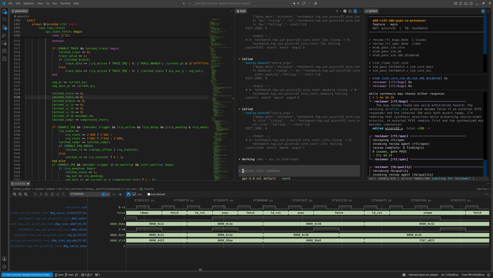

---
hide:
  - navigation
  - toc
---

# Booley

**The open-source agentic RTL IDE.**

Booley turns Claude Code or Codex into an RTL assistant. It runs the agent in a
Docker sandbox, gives it real EDA tools through one interface per flow (`sim`,
`lint`, `synth`, `fpga`), lets it query simulation waveforms directly, and
checks its work against your acceptance criteria: passing tests, area and timing
budgets, cycle counts, coverage. You design; it does the grunt work.

[GitHub](https://github.com/boldaxolotl/booley){ .md-button .md-button--primary }
[Documentation](https://github.com/boldaxolotl/booley#readme){ .md-button }
[Blog](blog/index.md){ .md-button }



## Install

Booley runs on Linux and Windows and needs Python 3.11+, Git, Docker, VS Code,
and Claude Code or Codex. With [pipx](https://pipx.pypa.io/) installed:

```bash
pipx install booley-rtl
booley bootstrap
```

Then follow the [setup guide](https://github.com/boldaxolotl/booley/blob/main/docs/user/SETUP.md)
for your own RTL project, or try the
[PicoRV32 demo project](https://github.com/boldaxolotl/booley-prj-picorv32).

## See it work

- [Design Optimization](https://youtu.be/zHuvU4QJbvE) (12:43)
- [Finding and Fixing Bugs](https://youtu.be/hsYHHZcx82w) (9:40)

Booley is free and open source under the Apache-2.0 license.
